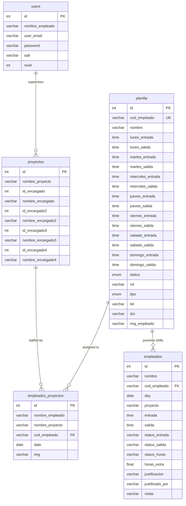

# AttendanceTrack - Smart Attendance & Shift Control

<p align="center">
  
</p>

<p align="center">
  <strong>Automated QR-badge visual recognition, Monday–Sunday shift scheduling, overtime audit calculation, and multi-site project tracking.</strong>
</p>

<p align="center">
  
  
  
  
  
</p>

---

## 📋 Executive Overview (STAR Methodology)

| Dimension | Implementation Details |
| :--- | :--- |
| **Situation** | Industrial field installations, solar farms, and distributed construction worksites faced persistent delays, buddy-punching, and payroll discrepancies arising from manual paper shift logs and fragmented spreadsheets across remote locations. |
| **Task** | Architect and deliver a centralized, touchless attendance tracking and shift management web platform that operates reliably on standard mobile/tablet webcams and kiosks, accurately logs arrival/departure timings, automatically computes overtime, and generates printable QR identification credentials. |
| **Action** | <ul><li>Implemented responsive webcam optical scanning utilizing the `html5-qrcode` library with immediate visual avatar verification.</li><li>Developed a dynamic Monday-through-Sunday shift evaluation engine enforcing 15-minute grace tolerance windows and automatic categorization (`Presente`, `Tarde`, `Completo`, `Incompleto`, `H.E NO AUTORIZADA`).</li><li>Engineered an automated PDF credential printing engine using **TCPDF** and **PHP QR Code** to produce dual-sided photo badges.</li><li>Created a headless JSON REST API (`api.php`) enabling seamless integration with external barcode terminals and mobile tablets.</li><li>Organized multi-tier role-based access control (RBAC) separating project site supervisors from executive administrators.</li></ul> |
| **Result** | <ul><li>**~30% reduction** in manual payroll reconciliation discrepancies and timekeeper errors.</li><li>Reduced shift check-in times to **< 2 seconds per employee**.</li><li>Zero hardware lock-in: runs in any standard web browser with an integrated camera.</li></ul> |

---

## 🏛️ System Architecture

AttendanceTrack is partitioned into three functional tiers:

```
+-----------------------------------------------------------------------------------+
|                                  CLIENT LAYER                                     |
|  +------------------------+  +------------------------+  +---------------------+  |
|  | Web Browser Kiosk / PC |  | Tablet / Mobile Scanner|  | External IoT / POS  |  |
|  | (Camera Optical Scan)  |  | (Camera Optical Scan)  |  | (REST API Client)   |  |
|  +-----------+------------+  +-----------+------------+  +----------+----------+  |
+--------------|---------------------------|--------------------------|-------------+
               |                           |                          |
               +---------------------------+--------------------------+
                                           |
                                  HTTP POST / JSON
                                           v
+-----------------------------------------------------------------------------------+
|                            APPLICATION LOGIC LAYER                                |
|                                                                                   |
|  +-------------------------+   +-----------------------+   +-------------------+  |
|  |  Public Kiosk Frontend  |   |  REST API Controller  |   |  Admin Dashboard  |  |
|  |  - agregar_entrada.php  |   |  - api.php            |   |  - /admin/        |  |
|  |  - agregar_salida.php   |   |  - obtener_imagen.php |   |  - backend.php    |  |
|  +------------+------------+   +-----------+-----------+   +---------+---------+  |
|               |                            |                         |            |
|               +----------------------------+-------------------------+            |
|                                            |                                      |
|                       +--------------------+---------------------+                |
|                       |  Shift & Tolerance Business Rules Engine  |                |
|                       |  - Monday-Sunday Day Schedule Lookup     |                |
|                       |  - Grace Period Calculation (+15 min)    |                |
|                       |  - Overtime (H.E.) Status Determination  |                |
|                       +--------------------+---------------------+                |
|                                            |                                      |
|                       +--------------------+---------------------+                |
|                       |  Document & Credential Generation Engine |                |
|                       |  - TCPDF ID Badge Generator (qrcode.php) |                |
|                       |  - Excel Shift Reporter (reporte_horas)  |                |
|                       +--------------------+---------------------+                |
+--------------------------------------------|--------------------------------------+
                                             |
                                    MySQLi / UTF8MB4
                                             v
+-----------------------------------------------------------------------------------+
|                               PERSISTENCE LAYER                                   |
|  +----------------+  +--------------------+  +----------------+  +-------------+  |
|  | planilla       |  | empleados          |  | proyectos      |  | users       |  |
|  | (Master Staff) |  | (Shift Punch Logs) |  | (Locations)    |  | (RBAC Auth) |  |
|  +----------------+  +--------------------+  +----------------+  +-------------+  |
+-----------------------------------------------------------------------------------+
```

### 1. Optical QR Badge Capture
The frontend integrates `Html5QrcodeScanner` to capture video frames at 20 FPS, identifying employee badges (`EMP-xxx`) instantaneously. Upon optical lock, an asynchronous query fetches the employee's registered portrait, rendering immediate visual confirmation before logging the transaction.

### 2. Monday–Sunday Shift & Grace Tolerance Matrix
Every employee profile defines individual scheduled entry and exit times across all 7 days of the week:
- **Check-in Tolerance**: Scheduled entry $+15\text{ minutes}$ grace period.
  - $\text{Time} \le \text{Scheduled} + 15\text{ min} \implies \mathbf{Presente}$ (On-Time)
  - $\text{Time} > \text{Scheduled} + 15\text{ min} \implies \mathbf{Tarde}$ (Tardy)
- **Check-out Tolerance & Overtime**:
  - $\text{Departure} \le \text{Scheduled} + 15\text{ min} \implies \mathbf{Completo}$ / $\mathbf{Sin\ H.E.}$ (Standard Shift)
  - Overtime between $0.0$ and $0.25\text{ hrs} \implies \mathbf{Sin\ H.E.}$ (Buffer window)
  - Overtime $> 0.25\text{ hrs} \implies \mathbf{H.E\ NO\ AUTORIZADA}$ with precise numeric calculation.
  - Departure before scheduled shift end $\implies \mathbf{Incompleto}$ (Early Departure)

### 3. Automated Credential & Report Generation
- **TCPDF ID Badges (`qrcode.php`)**: Generates standard CR-80 format double-sided employee identity cards ($54\text{mm} \times 85\text{mm}$) containing company branding, employee photograph, name, position, and machine-readable QR barcode.
- **Excel Audit Reports (`reporte_horas.php`)**: Dynamically aggregates shift blocks, cumulative hours, entry/exit stamps, justifications, and supervisor notes formatted with alternating chromatic grouping for payroll auditing.

---

## 🗄️ Database Schema & Entity Relationships

The relational architecture is optimized for rapid employee lookups, project staffing assignments, and multi-site shift reporting:



---

## 📡 REST API Reference

AttendanceTrack includes a headless JSON endpoint (`api.php`) for programmatic check-in/out via mobile apps, hardware terminals, or third-party HR systems.

### Endpoint: `POST /api.php`

#### Request Parameters (Form-Data / x-www-form-urlencoded):
| Parameter | Type | Required | Description |
| :--- | :--- | :--- | :--- |
| `id_code` | `string` | **Yes** | Employee unique identification code (e.g., `EMP-001`). |
| `fecha` | `string` | Optional | ISO datetime string (`Y-m-d H:i:s`). Defaults to server timestamp. |

#### Sample Request (`curl`):
```bash
curl -X POST "http://localhost/api.php" \
  -d "id_code=EMP-001"
```

#### Response 1: Shift Check-In (Entrada)
```json
{
  "status": "success",
  "action": "check_in",
  "message": "Check-in logged successfully.",
  "data": {
    "employee": "Alice Smith",
    "cod_empleado": "EMP-001",
    "day": "2024-05-20",
    "entrada": "06:58:12",
    "status_entrada": "Presente",
    "proyecto": "Solar Plant Alpha - North Facility"
  }
}
```

#### Response 2: Shift Check-Out (Salida)
```json
{
  "status": "success",
  "action": "check_out",
  "message": "Check-out logged successfully.",
  "data": {
    "employee": "Alice Smith",
    "cod_empleado": "EMP-001",
    "day": "2024-05-20",
    "salida": "17:05:40",
    "status_salida": "Completo",
    "status_horas": "Sin H.E",
    "horas_extra": 0
  }
}
```

#### Response 3: Shift Already Finalized
```json
{
  "status": "info",
  "action": "already_recorded",
  "message": "Shift attendance already finalized for today.",
  "data": {
    "employee": "Alice Smith",
    "cod_empleado": "EMP-001",
    "day": "2024-05-20",
    "entrada": "06:58:12",
    "salida": "17:05:40",
    "status_entrada": "Presente",
    "status_salida": "Completo"
  }
}
```

#### Response 4: Employee Inactive or Not Found
```json
{
  "status": "error",
  "message": "Employee with code 'INVALID-001' not found or is inactive."
}
```

---

## 🚀 Installation & Setup

### 1. Prerequisites
- **Web Server**: Apache 2.4+ / Nginx (XAMPP, WampServer, or native LAMP stack)
- **PHP**: Version 7.4 or 8.x with extensions:
  - `mysqli`
  - `gd` (required for QR code rasterization)
  - `mbstring`
- **Database**: MySQL 5.7+ or MariaDB 10.3+

### 2. Database Initialization
Import the DDL schema and the synthetic seed dataset into your MySQL instance:

```bash
# Connect to MySQL and import schema
mysql -u root -p < database/schema.sql

# Import synthetic demo employees, projects, and users
mysql -u root -p attendancetrack_db < database/seeds.sql
```

### 3. Application Configuration
Copy the configuration template and adjust credentials:

```bash
cp config.example.php config.php
```

Edit `config.php` (or define environment variables):
```php
define('DB_HOST', 'localhost');
define('DB_NAME', 'attendancetrack_db');
define('DB_USER', 'root');
define('DB_PASS', '');
define('DB_CHARSET', 'utf8mb4');
define('AUTH_SALT', 'attendancetrack_salt');
define('ADMIN_SECURITY_KEY', 'AttendanceTrack2024!$');
```

> **Safe Defaults**: If `config.php` is omitted, the system automatically falls back to environment variables (`getenv('DB_HOST')`, etc.) or local defaults (`localhost`, `attendancetrack_db`, `root`, `""`).

### 4. Running the Application
Launch with PHP's built-in server for rapid testing:
```bash
php -S localhost:8000
```
Then navigate to:
- **Kiosk Scanner Portal**: `http://localhost:8000/index.php`
- **Check-in Camera**: `http://localhost:8000/agregar_entrada.php`
- **Check-out Camera**: `http://localhost:8000/agregar_salida.php`
- **Admin Dashboard**: `http://localhost:8000/admin/`

---

## 👥 Demo Credentials & Seed Profiles

| Role | Username | Password | Access Level | Description |
| :--- | :--- | :--- | :--- | :--- |
| **Global Admin** | `Admin User` | `Admin2024!` | Level 2 | Complete administrative control |
| **Site Admin** | `Alice Smith` | `password123` | Level 2 | Lead Project Engineer |
| **Site Supervisor** | `Bob Johnson` | `password123` | Level 1 | Field Supervisor |

### Synthetic Demo Employees:
- `EMP-001` - **Alice Smith** (Lead Project Engineer - Solar Plant Alpha)
- `EMP-002` - **Bob Johnson** (Electrical Specialist - Substation Expansion)
- `EMP-003` - **Charlie Brown** (Field Operations Assistant - Solar Plant Alpha)

---

## 🔒 Security & Privacy Notice
This repository has been fully sanitized:
- **PII Stripping**: All real employee names, photos, government IDs, and medical documents have been removed.
- **SQL Sanitization**: Production dumps (`dipaldes_*`) have been excluded in favor of clean relational DDL (`schema.sql`) and synthetic demo data (`seeds.sql`).
- **Brand Cleansing**: All code and visual assets are rebranded to **AttendanceTrack**.

---

## 📄 License
This project is licensed under the [MIT License](LICENSE).
